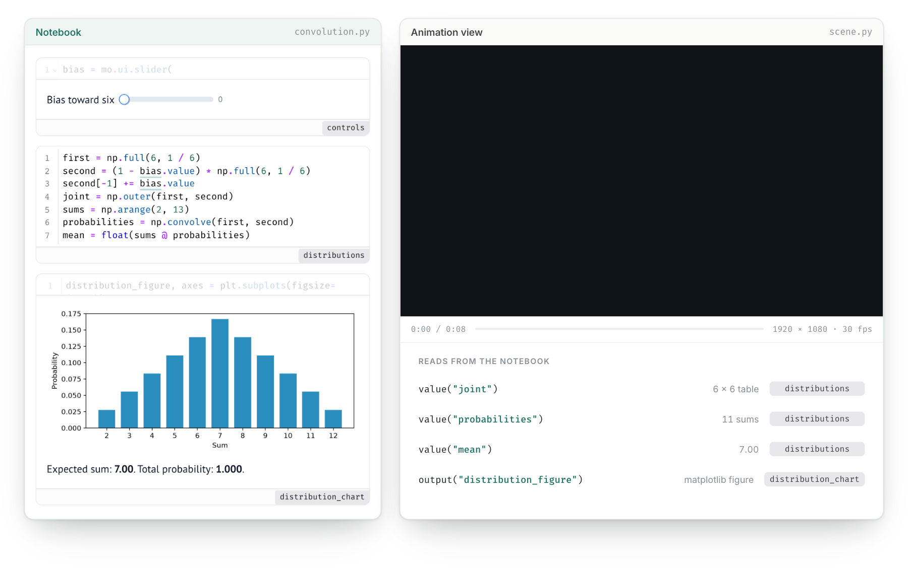
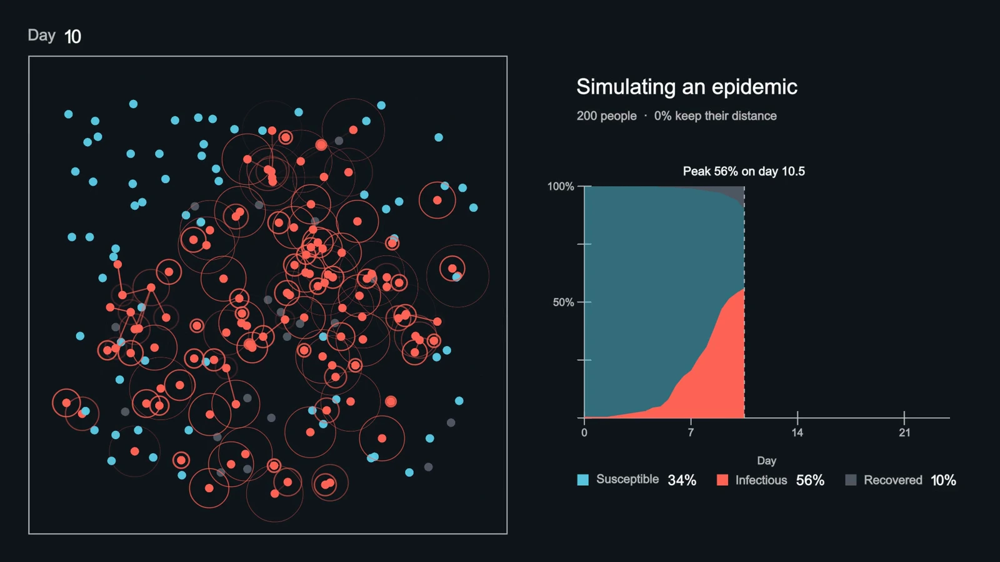

# marimo-manim

marimo-manim brings [Manim](https://github.com/3b1b/manim) animations to
[marimo](https://marimo.io/) notebooks through
[marimo-studio](https://marimo-team.github.io/marimo-studio/). The notebook
computes the values. A Manim scene in a Studio view animates them, and Studio
renders the movie again whenever a value changes.

<picture>
  <source media="(prefers-color-scheme: dark)" srcset="docs/public/media/hero-dark.webp">
  
</picture>

```python
import numpy as np
from manimlib import Scene, ShowCreation, VMobject
from marimo_manim import value


class Animation(Scene):
    def construct(self):
        points = np.asarray(value("trajectory", default=[[0, 0], [1, 1]]), dtype=float)
        curve = VMobject()
        curve.set_points_as_corners(np.column_stack((points, np.zeros(len(points)))))
        self.play(ShowCreation(curve), run_time=3)
```

`trajectory` is a variable in the notebook. The view's page plays the movie
beside the notebook's live controls, and `output()` and `cell()` place notebook
figures inside the scene.

## Get started

marimo-manim renders scenes in the notebook's [pixi](https://pixi.sh/)
environment, which installs the OpenGL and Pango libraries ManimGL renders with
from conda-forge. Declare it in the notebook's script metadata:

```python
# /// script
# requires-python = ">=3.10,<3.15"
# dependencies = [
#     "marimo-manim[render] @ git+https://github.com/peter-gy/marimo-manim",
# ]
#
# [tool.pixi.workspace]
# channels = ["conda-forge"]
#
# [tool.pixi.dependencies]
# manimpango = ">=0.6"
# ///
```

```sh
uvx --with "marimo-manim @ git+https://github.com/peter-gy/marimo-manim" \
  marimo edit analysis.py --sandbox=pixi --watch
```

In Studio, click **Add view** and choose **Manim animation**.
[Getting started](https://peter-gy.github.io/marimo-manim/guide/getting-started)
shows the complete metadata, including the Mesa tables that render on Linux
servers without a display.

## Author with a coding agent

marimo-manim ships an agent skill beside marimo-studio's. Paste this into
Claude Code, Codex, or another terminal agent:

```text
Read the marimo-studio and marimo-manim skills with
`uvx --with "marimo-manim @ git+https://github.com/peter-gy/marimo-manim" agent-plugins read <name>`,
then create a notebook that explains Fourier series and an Animation view
that draws a square wave from rotating vectors.
```

## Examples

[](https://peter-gy.github.io/marimo-manim/examples/epidemic)

- [Simulating an epidemic](https://peter-gy.github.io/marimo-manim/examples/epidemic):
  two hundred people simulated in the notebook, after 3Blue1Brown's
  *Simulating an epidemic*. Pause the movie and point at anyone to trace them
  to the notebook row that simulated them.
- [Fourier drawing](https://peter-gy.github.io/marimo-manim/examples/fourier):
  rotating vectors and a spectrum from Fourier coefficients.
- [Convolution of dice](https://peter-gy.github.io/marimo-manim/examples/convolution):
  a joint probability table folding into the distribution of a sum, ending on
  the notebook's own chart.

```sh
pixi run edit epidemic
```

## Documentation

[Guide](https://peter-gy.github.io/marimo-manim/guide/getting-started) ·
[Examples](https://peter-gy.github.io/marimo-manim/examples/) ·
[Reference](https://peter-gy.github.io/marimo-manim/reference/python-api) ·
[Contributing](CONTRIBUTING.md)

## License

[Apache License 2.0](LICENSE). The epidemic example's
[`scene.py`](examples/studio/epidemic/animation/scene.py) adapts code from
[3b1b/videos](https://github.com/3b1b/videos) and shares its
[CC BY-NC-SA 4.0](https://creativecommons.org/licenses/by-nc-sa/4.0/) license.
